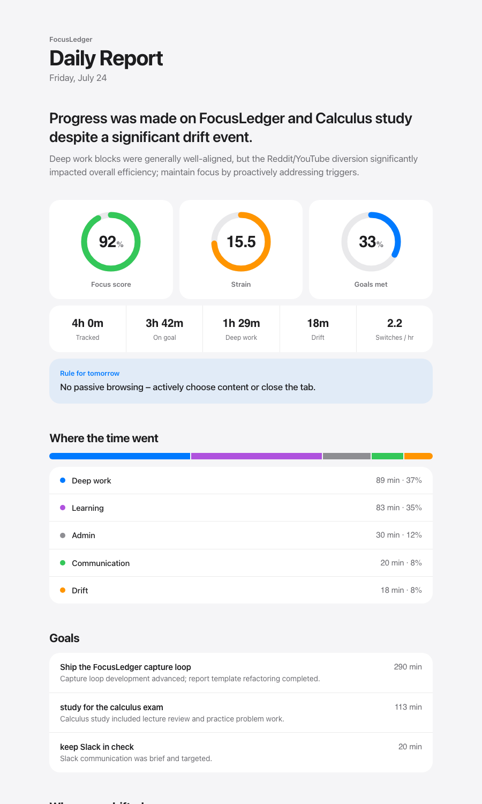
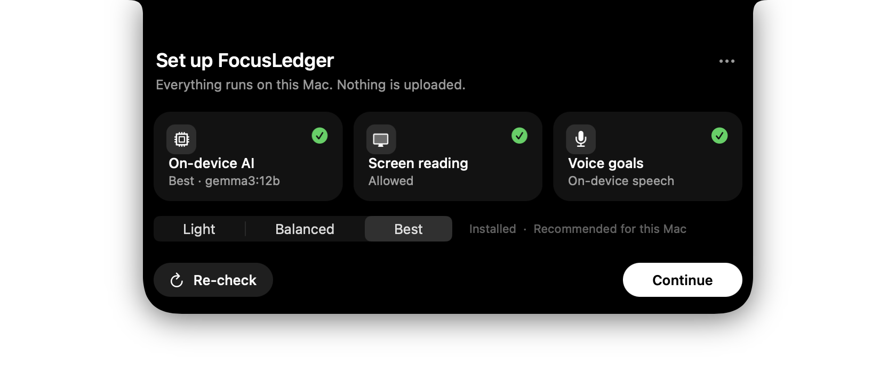

<div align="center">
  <h1>FocusLedger</h1>
</div>

<div align="center">
  <h3>Tells you whether your day matched your goals — judged by a Gemma model that never leaves your Mac.</h3>
</div>

<div align="center">
  
  
  
  
</div>

<br>

<div align="center">
  
  <br><sub>The end-of-day report, rendered from the sample ledger in this repo.</sub>
</div>

<br>

You say your goals each morning. FocusLedger sits in the notch, reads
your focused window with Apple Vision OCR while you work, deletes the
screenshot immediately, and every 30 minutes asks a local Gemma model
whether that block served a goal. At the end of the day it writes one
report. The only network call is to `localhost:11434`.

```bash
git clone https://github.com/Aaryan1524/305Gemma-efficiencyproj.git
cd 305Gemma-efficiencyproj
./start.sh
```

> [!NOTE]
> The first run includes a one-time model download (0.8 GB to 8.1 GB
> depending on the size you pick). It happens inside the app, with a
> progress bar, and only after you click **Download**.

## Why use FocusLedger?

- **Measures intent, not apps** — "3h in Chrome" can't tell calculus
  from YouTube. FocusLedger judges the content against what you said
  you'd do.
- **Local by construction** — screenshots are deleted in a `finally`
  block, raw text lives only in memory, and the ledger on disk holds
  verdicts. No pixels, no raw text, ever.
- **Honest hours** — sessions open and close on macOS idle time, so a
  laptop left open overnight logs nothing.
- **Pick your model size** — Light (1B), Balanced (4B) or Best (12B),
  chosen from your RAM by default, switchable any time.
- **Silent all day** — no popups, no streaks, no "are you focused?".

```
your goals  →  idle gate  →  OCR (image deleted)  →  Gemma verdict  →  report
(morning)      (10s poll)     (Apple Vision)          (every 30 min)     (end of day)
```

<div align="center">
  
  <br><sub>First launch with everything ready. Until Screen Recording is granted, the middle card reads "Allow, then reopen app".</sub>
</div>

---

## Requirements

| You need | Why | Check |
|---|---|---|
| A Mac with Apple Silicon (the only hardware tested) | Vision OCR and local Gemma | `uname -m` prints `arm64` |
| macOS (developed and tested on macOS 26; older versions untested) | notch APIs, SF Symbols, on-device speech | `sw_vers -productVersion` |
| Python 3 | the app itself | `python3 --version` |
| [Ollama](https://ollama.com/download) | runs Gemma locally | `ollama --version` |
| Xcode Command Line Tools *(optional)* | builds the voice-goals helper | `xcode-select -p` |
| 8 GB RAM or more; 16 GB or more suits the 12B model | model size | the setup screen recommends one |

A MacBook with a notch is not required. Without one, the panel opens
at the top centre of the screen.

## Setup

### 1. Install and launch

```bash
./start.sh
```

This creates `venv/`, installs the Python packages, builds
`Dictate.app` (voice) and `FocusLedger.app`, starts Ollama if it isn't
running, and opens the notch. It is safe to run again.

### 2. Walk through the setup screen

Click the notch at the top of the screen. Each card shows a check when
it is ready, or one button to fix it.

| Card | If it isn't ready | What to click |
|---|---|---|
| **On-device AI** | Ollama missing, stopped, or model not downloaded | **Get Ollama**, **Start**, or **Download** |
| **Screen reading** | macOS hasn't granted Screen Recording | **Allow**, then switch the toggle on, then **quit and reopen FocusLedger** |
| **Voice goals** | helper not built (no Xcode tools) | **Build**, or skip: typing goals works |

**Screen Recording takes effect only after a relaunch.** This is macOS
behaviour: toggling it on and pressing **Re-check** is not enough. Quit
(`…` menu, **Quit FocusLedger**) and run `./start.sh` or open
`FocusLedger.app` again. The permission is granted to the Python that
runs the app, so macOS may list it as **Python**.

The **Light / Balanced / Best** control picks the model. Your RAM sets
the default; the caption says what is installed and what to expect.
**Continue** unlocks when AI and Screen reading are both ready.

### 3. Set today's goals and start

Type your goals or press **Speak** (on-device speech), then **Start
day**. The notch shrinks into a status dot and a session timer.

### 4. Try the whole loop in under a minute

1. In the `…` menu, turn on **Test mode (1-minute checkpoints)**. Do
   this before pressing **Start day**.
2. Work in any app for 15 to 30 seconds.
3. Click the notch and press **View report**. FocusLedger flushes what
   it has seen through Gemma and opens the report in your browser.
4. Use **End day** when you're finished, then **New day** to start
   fresh.

Don't have a day of data yet? `…` menu, **Preview a full-day report**
adds seeded afternoon and evening sessions to your real ones.

### 5. Confirm everything works

```bash
./start.sh --verify    # 14 checks: deps, Ollama, permissions, OCR, Gemma, report
```

## Using it every day

| Where | What it does |
|---|---|
| Notch, collapsed | Status dot and session timer. Click to open. |
| **Start day** | Begins tracking against today's goals. |
| **View report** | Judges the live buffer now, then opens the report. |
| **End day** | Final checkpoint, closes the session, opens the report. |
| `…` menu | Setup, model size, test mode, sample goals, demo report, new day, quit. |

To launch at login: `./venv/bin/python notch.py --install-login`.

## Choosing a model

| Size | Download | Use it when |
|---|---|---|
| **Light** `gemma3:1b` | 0.8 GB | Old or 8 GB machines. Fastest, but it keeps the JSON format while sometimes misjudging the activity (it labelled coding as "communication" in our check). |
| **Balanced** `gemma3:4b` | 3.3 GB | Most Macs. Passed our classification and prompt-injection checks, and ran faster than 12B. |
| **Best** `gemma3:12b` | 8.1 GB | 16 GB or more. The most reliable verdicts. |

The choice is saved to
`~/Library/Application Support/FocusLedger/config.json` and shared by
the tracker, the report and the demo seeder. `FL_MODEL=gemma3:4b
./start.sh` overrides it for one run.

## Privacy

- **Session-gated** — polls `ioreg HIDIdleTime` every 10 s. Captures
  only while you're active; idle time is never observed.
- **Images deleted the instant they're read** — a screenshot lives on
  disk for the length of one OCR call. `captures/` stays empty.
- **Raw text never persisted** — held in memory until the next
  checkpoint turns it into a verdict.
- **Blocklist** — never captured: 1Password, Keychain Access,
  Bitwarden, Messages, Signal, FaceTime, and any window titled
  *bank*, *chase*, *wells fargo*, *password*, *login*, *sign in*,
  *checkout*, *payment*, *incognito* or *private browsing*.
- **Screen text is untrusted** — the model's reply is forced into a
  JSON schema, so instructions that happen to be on screen can't hijack
  the verdict.

What is stored: `ledger.jsonl` (verdicts and session times, in this
folder, gitignored) and `config.json` (your model choice).

## Directory layout

```
305Gemma-efficiencyproj/
├── start.sh              one-command setup + launcher (--quick / --onboarding / --verify / --demo-report)
├── build_app.sh          builds FocusLedger.app (finds the repo from its own location)
├── build_dictate.sh      compiles the Swift speech helper into Dictate.app
├── notch.py              the notch UI: setup, goals, tracking, report controls
├── focusledger.py        session manager + capture loop, SIGUSR1 live flush
├── gemma.py              Ollama client, both prompts, model catalog, downloads
├── vision_ocr.py         Apple Vision OCR; image deleted right after
├── report.py             ledger → Gemma synthesis → HTML report
├── templates/report.html the report page (light and dark)
├── seed.py               generates demo sessions
├── verify_setup.py       the 14-check preflight
├── ledger.sample.jsonl   committed sample for the demo report
└── docs/images/          README screenshots
```

### Why a separate `Dictate.app`

macOS blames the *parent* process for a microphone request. A helper
spawned by `python` is killed with `TCC_CRASHING_DUE_TO_PRIVACY_VIOLATION`
because Python carries no usage description. Launching the helper with
`open` hands it to LaunchServices, which makes it its own responsible
process. This bit us five times before we found it.

## Known gaps

- **macOS on Apple Silicon only.** It uses Apple Vision, AppKit and
  on-device speech. Intel Macs and other platforms are untested.
- **Screen Recording belongs to Python, not "FocusLedger".** The app
  bundle is a launcher script, so macOS asks on behalf of the Python
  that runs it. A signed, notarized build would fix this; it doesn't
  exist yet.
- **Single monitor.** Only the primary display is captured.
- **1B accuracy is limited.** It holds the output format but can pick
  the wrong category. Use 4B or 12B for results you'll act on.
- **Checkpoint latency varies** (about 5 s to 100 s depending on model
  and load), so *View report* can take a moment.
- **The demo report mixes real and seeded data.** The seeded evening
  sessions come from `seed.py`.
- **`FocusLedger.app` must stay inside the repo folder.** It finds the
  repo from its own location (moving the whole folder works; copying
  the `.app` alone to `/Applications` does not), and it shows an alert
  if `./start.sh` hasn't been run yet.

## Troubleshooting

```bash
./start.sh --verify                  # which of the 14 checks fails
curl -s localhost:11434/api/tags     # is Ollama up, and which models exist
ollama list                          # installed models
cat ~/Library/Application\ Support/FocusLedger/config.json   # saved model choice
```

**Screen reading still says "Allow, then reopen app" after you granted
it.** Quit FocusLedger completely and launch it again; the permission
only applies to a new process. If it still fails, open System Settings,
Privacy & Security, Screen & System Audio Recording, and make sure the
entry (often **Python**) is on.

**Continue is dimmed.** AI or Screen reading isn't ready. Press
**Re-check** after fixing the card that shows a button.

**"Ollama isn't running" and Start does nothing.** Open the Ollama
app once, or run `ollama serve` in a terminal, then **Re-check**.

**"`gemma3:…` not downloaded yet."** Press **Download**. If it fails,
run `ollama pull gemma3:4b` yourself and press **Re-check**.

**Voice says "Not built yet".** Run `xcode-select --install`, then
`./build_dictate.sh`. Typing goals works without it.

**The report is empty or shows "(Gemma synthesis unavailable…)".**
Ollama wasn't reachable or the model wasn't installed when the report
ran. Start Ollama, then press **View report** again.

**A checkpoint never lands.** A 12B model on a busy 8 GB Mac can exceed
the 180 s timeout. Switch to Balanced in the `…` menu.

**The notch looks fine but nothing is tracked.** Tracking pauses while
you're idle and while the frontmost app or window title is on the
blocklist. The status line says "Skipped a private window" when that
happens.

## Uninstall

```bash
launchctl unload ~/Library/LaunchAgents/com.focusledger.notch.plist 2>/dev/null
rm -f ~/Library/LaunchAgents/com.focusledger.notch.plist      # login launch, if you enabled it
rm -rf ~/Library/Application\ Support/FocusLedger              # saved model choice
ollama rm gemma3:12b gemma3:4b gemma3:1b                       # models you downloaded, optional
cd .. && rm -rf 305Gemma-efficiencyproj                        # the app, ledger and report
```

Then remove **Python** from System Settings, Privacy & Security,
Screen & System Audio Recording.

## Built for

The 305 SummerCodex **Build with Gemma** hackathon (FIU, July 24, 2026).
Libraries: Ollama · Gemma 3 · pyobjc (Vision, Quartz, AppKit) · mss ·
Jinja2 · requests.
